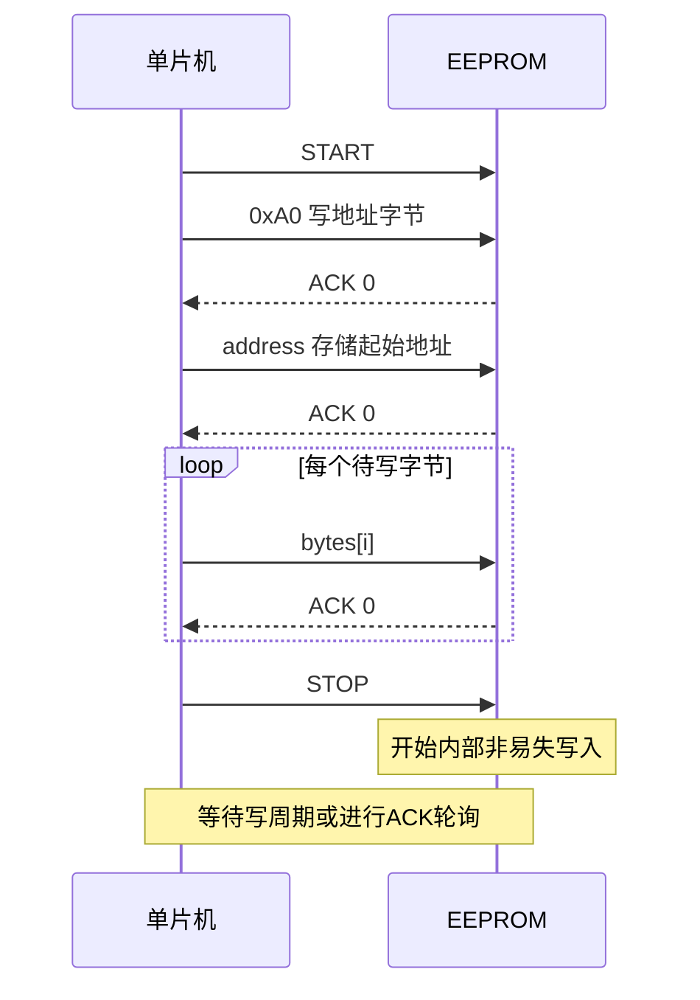
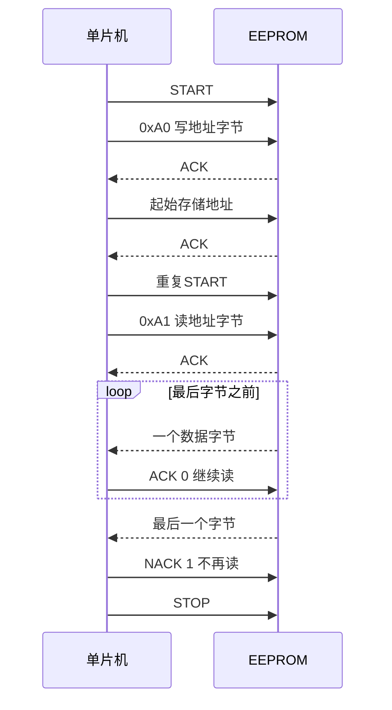

# EEPROM 读写模块笔记

这份笔记对应当前 `Int_EEPROM.c/.h` 与 `main.c` 的“写入字模、读回并滚动显示”实验，参考课程 Word 的“I2C 协议 EEPROM”章节。先掌握 [IIC 模块笔记](IIC模块笔记.md) 中的 START、STOP、ACK 和字节收发，再理解本模块如何组合这些动作。

## 1 EEPROM 保存的是什么

EEPROM 是断电后仍能保存数据的存储器。它保存字节，不认识汉字；“尚硅谷”是把点阵图案编码成字节数组之后，由显示模块解释出来的。

Word 指定课程器件为 AT24C02CN，容量为 2 Kbit，即 256 字节。项目用 `u8 address` 表示字节地址，范围为 `0x00～0xFF`。

```text
2 Kbit = 2048 bit = 256 byte
```

当前工程配置：

```c
#define DEV_ADDR  0xA0
#define PAGE_SIZE 16
```

`PAGE_SIZE = 16` 是当前源码和课程示例的配置。**页大小必须核对板上实际芯片的完整型号及数据手册**：不同 24C02 型号可能采用不同页大小，常见型号也有 8 字节页，不能从“256 字节容量”直接推断出 16 字节页。下面分页面例按当前配置 16 字节计算。

## 2 三种地址或位置不要混淆

| 名称 | 本项目例子 | 表示什么 |
|---|---|---|
| I²C 设备地址字节 | `0xA0` 写，`0xA1` 读 | 选择总线上的 EEPROM 及传输方向 |
| EEPROM 字节地址 | `address = 0x14` | 选择 EEPROM 内第 20 个字节位置 |
| C 数组或指针位置 | `bytes[i]`、`bytes += n` | 单片机要发送或保存数据的位置 |

`Dri_IIC_SendByte(DEV_ADDR)` 与 `Dri_IIC_SendByte(address)` 虽然都发送一个字节，但含义完全不同。

## 3 当前对外接口

| 函数 | 用途 | 主要约束 |
|---|---|---|
| `Int_EEPROM_WritePage(address, bytes, len)` | 发起一次页写事务 | 不能超出起始地址所在页的剩余空间 |
| `Int_EEPROM_WriteBytes(address, bytes, len)` | 自动拆成多个页写事务 | 每页写后等待内部写入完成 |
| `Int_EEPROM_ReadBytes(address, bytes, len)` | 从指定地址连续读取 | 数组要能容纳 `len` 个字节 |

当前这三个函数都是 `void`，调用者得不到成功或失败状态。Word 示例则返回 `bit`，约定 `0` 表示无 NACK，`1` 表示遇到 NACK，后面会单独解释。

一般让业务代码调用 WriteBytes 和 ReadBytes。WritePage 可以作为 `.c` 内部辅助函数；若改为内部函数，可加 `static` 并移除头文件声明。当前项目仍公开它，笔记不改源码。

头文件中“ReadBytes 内部调用 WritePage”的现有注释不准确：**WriteBytes 调用 WritePage，ReadBytes 不调用 WritePage。**

## 4 页写事务的顺序

当前页写函数组织的总线流程是：

```text
START → 0xA0 → ACK → 字节地址 → ACK
      → 数据0 → ACK → 数据1 → ACK → … → STOP
```



关键代码结构：

```c
Dri_IIC_Start();
Dri_IIC_SendByte(DEV_ADDR);
Dri_IIC_ReceiveAck();
Dri_IIC_SendByte(address);
Dri_IIC_ReceiveAck();

for (i = 0; i < len; i++) {
    Dri_IIC_SendByte(bytes[i]);
    Dri_IIC_ReceiveAck();
}

Dri_IIC_Stop();
```

当前实现把 ACK 读出来后直接丢弃，即使设备未响应仍继续发送。因此函数返回不意味着写入成功。

### 4.1 为什么 STOP 后还要等

I²C 数据传输与 EEPROM 内部写入是两件事。总线上发送结束后，EEPROM 还需要时间把接收到的数据写到非易失存储单元。

当前 WritePage 本身不延时，WriteBytes 每次页写后调用：

```c
Delay1ms(3);
```

Word 说明文字写了 3 ms，但多页写示例用了 5 ms，并且示例仅在跨页分支等待，最后一页没有统一等待。应以实际器件手册规定的写周期为准；马上读取时，最后一页同样必须完成内部写入。当前代码在每页后等待的结构更一致，但 3 ms 是否足够仍需核对。

更可靠的方式是 ACK 轮询：STOP 后重复发起设备写地址探测，忙时 NACK，就绪后 ACK；轮询必须有超时，并且每次探测正确结束总线事务。

### 4.2 页写跨页为什么会错

页写通常只递增页内的低位地址，超过页尾会在当前页内回绕，而不会自动写到下一页。

按 16 字节页，地址 0 开始一次发送 26 字节时：

```text
前16字节：写到 0～15
后10字节：回绕到 0～9，可能覆盖前面的内容
```

所以不能写：

```c
Int_EEPROM_WritePage(0x00, picture, 26);
```

应使用：

```c
Int_EEPROM_WriteBytes(0x00, picture, 26);
```

即使 `len <= PAGE_SIZE`，也不一定能一次页写。例如从地址 14 开始写 4 个字节，仍然越过了 16 字节页的边界。

## 5 自动跨页写入怎样计算

核心公式：

```c
page_remain = PAGE_SIZE - address % PAGE_SIZE;
```

`address % PAGE_SIZE` 是当前地址在页内的偏移，减掉它就是当前页还能写多少字节。

若剩余数据比这一页空间多，先填完当前页：

```c
Int_EEPROM_WritePage(address, bytes, page_remain);
len -= page_remain;
address += page_remain;
bytes += page_remain;
```

这里三个变量各有职责：

- `len` 减小：还剩多少数据没写。
- `address` 增加：下一次写入的 EEPROM 地址。
- `bytes` 增加：下一次从原数组的哪个位置取数据。

数组参数 `u8 bytes[]` 在函数参数位置相当于 `u8 *bytes`。函数里的 `bytes += n` 改变的是指针副本，不会移动数组内容，也不会修改调用方变量的指针值。

### 5.1 当前26字节字模的分配

按 `PAGE_SIZE = 16`，起始地址为 0：

| 事务 | 起始地址 | 数组起点 | 写入数量 | 写入地址范围 |
|---|---|---|---|---|
| 第一次 | 0 | `picture[0]` | 16 | 0～15 |
| 第二次 | 16 | `picture[16]` | 10 | 16～25 |

若从地址 14 开始写 20 字节：

```text
第一笔 2 字节：14～15
第二笔16字节：16～31
第三笔 2 字节：32～33
```

若实际芯片是 8 字节页，就应把页大小改为 8；26 字节会拆成 8、8、8、2，而不是上面的 16、10。

### 5.2 地址越界不是正常跨页

跨过页边界可以由 WriteBytes 拆分处理，跨过整个 EEPROM 容量边界则需要另一套检查。

当前地址是 `u8`，255 后再增加会回到 0。如果不希望覆盖存储器开头，操作前应检查：

```c
/* 256字节器件的范围检查示意。 */
if ((u16)address + len > 256U) {
    /* 超出容量，应拒绝此次操作。 */
}
```

当前 API 的 `len` 也是 `u8`，一次最多表达 255 字节；数值 256 转成 `u8` 会变为 0，不能直接传入。更大容量器件是否需要两字节存储地址或设备地址中的块选择位，应按其手册设计，不能只换成 `u16` 就认为协议完成了。

## 6 指定地址连续读

当前 ReadBytes 使用“伪写设置地址 + 重复起始 + 连续读”：

```text
START → 0xA0 → ACK → 起始存储地址 → ACK
重复START → 0xA1 → ACK
数据0 → 主机ACK → 数据1 → 主机ACK → …
最后一个数据 → 主机NACK → STOP
```



前半段虽然发送了写地址字节 `0xA0`，但没有发送要写入的内容，只设置内部地址指针，所以叫伪写或 Dummy Write。它不等于真正写入字模。

读取循环：

```c
for (i = 0; i < len; i++) {
    bytes[i] = Dri_IIC_ReceiveByte();
    Dri_IIC_SendAck(i == len - 1 ? 1 : 0);
}
```

`i == len - 1` 判断是否最后一个字节：不是最后一个发 0（ACK），最后一个发 1（NACK），然后 Stop。

读通常允许跨页连续递增；到器件容量末尾时是否回绕，应查手册。页写限制不能直接套到连续读上。

## 7 ACK 返回值为什么容易搞反

底层 ReceiveAck 返回原始总线电平：

```text
0 → ACK
1 → NACK
```

Word 中使用：

```c
bit ack = 0;
ack |= Dri_IIC_ReceiveAck();
```

只要任意一步出现 NACK，累计结果就会保持为 1：

```text
0 | 0 | 0 = 0 → 所有检查都收到ACK
0 | 1 | 0 = 1 → 至少一步收到NACK
```

因此课程版本返回 `0` 表示无检测到的 ACK 错误，`1` 表示至少出现一次 NACK。它不代表完整验证了 EEPROM 中实际保存的数据。

你当前 WritePage/WriteBytes/ReadBytes 的返回类型都是 `void`；ReadBytes 的 `ack` 被反复赋值，没有返回或判断，所以也没有错误反馈。

后续改进可以在每一步 NACK 时发送 Stop 并立即返回错误。若改成“1 成功、0 失败”也可以，但必须同时统一声明、实现和所有调用方，不能混用两种约定。以下例子沿用课程的 `0` 成功约定，仅展示判断思路：

```c
/* 示意：不是当前void API可直接使用的代码。 */
if (Int_EEPROM_WriteBytes(address, bytes, len) != 0) {
    /* 处理失败。 */
}
```

## 8 当前 main 的字模实验

当前调用顺序：

```c
Int_EEPROM_WriteBytes(0x00, picture, 26);
Dri_Timer0_Init();
Int_MatrixLed_Init();
Int_EEPROM_ReadBytes(0x00, picture, 26);
```

同一个 `picture` 数组先作为写入来源，再作为读取目标。读函数会覆盖数组原内容，后面的显示使用的是读回来的字节。


26 字节图案后再插入 8 个空字节，循环长度为 34：

```c
if (i < 26) {
    Int_MatrixLed_DataLine(picture[i]);
} else {
    Int_MatrixLed_DataLine(0);
}
```

点阵只有 8×8，不能同时完整显示三个字，看到的是逐步移动的图案。Word 示例字模有 27 字节，最后附带一个空字节；当前数组省略这个末尾空字节，并另外插入 8 个空行。

### 8.1 写入与显示建议分开验证

调试时先直接用原始 picture 显示，暂时跳过 EEPROM 写和读；确认点阵能正确滚动，再恢复 EEPROM 流程。这样能区分总线数据错误和显示扫描错误。

验证掉电保存时，先运行一次写入程序，再烧录或运行只读取的版本。若每次启动都重新写入，能显示并不能独立证明保存效果，而且会增加擦写次数。

## 9 曾经遇到的三个关键错误

| 错误 | 后果 | 当前状态或正确写法 |
|---|---|---|
| 一次 WritePage 写26字节 | 可能在页内回绕，覆盖前面数据 | main 已改用 WriteBytes |
| `byte |= (byte << 1) | SDA` | 把旧位重复保留，读回字节错误 | 已改成 `byte = (byte << 1) | SDA` |
| 读完用 SendByte 发确认 | 产生8个时钟，破坏第9位确认与后续数据 | 已改用 SendAck |

另外，页写后没有等待就立即读，可能遇到设备仍忙、地址不确认。延时长短应查手册或用 ACK 轮询判断就绪。

## 10 内存和声明问题

### 10.1 函数原型必须一致

`.h` 声明 `bit`，`.c` 定义 `void`，会导致编译类型冲突。main 调用未声明的函数会出现 C206/C267。改变接口时应同时修改头文件和调用代码。

### 10.2 C51 的 DATA 很小

SMALL 模型下，普通变量常放在直接 DATA 区，范围是低128字节。main 同时定义两个26字节数组会占用52字节；当前用同一个数组读写能减少占用。

普通 C51 非重入函数的局部变量通常由编译器静态分配并参与覆盖分析，不能简单认为“局部数组一定在栈上，所以不占 DATA”。具体分配看 `build/Debug/template.map`。

固定字模可以放到 `code` 区节省 RAM，但读取目标必须可写，不能让 ReadBytes 写入 `code` 数组。需要另设可写接收缓冲区，或改变读取显示策略。C51 通用指针可指向多个存储区；专用指针则需显式匹配 `code`、`idata` 等类型。

## 11 当前仍需检查的事项

当前三个关键传输错误已修正，但还需要逐项确认：

1. 实物 EEPROM 页大小是否与 `PAGE_SIZE = 16` 一致。
2. 设备地址脚是否对应 `0xA0/0xA1`，写保护 WP 是否处于允许写入状态。
3. 每个 ACK 都读到 0；NACK 不能忽略。
4. 写入结束后的等待是否覆盖手册要求，最后一页也要等待。
5. 起始函数对重复起始是否可靠，SDA/SCL 的上拉和时序是否合适。
6. 点阵移位寄存器启动时是否已清零，切换行前是否关闭列输出以避免串光。
7. 字模方向、扫描方向和点阵引脚映射是否一致。

点阵模块第6、7项属于显示层，不应通过随意改变 EEPROM 数据来掩盖。

## 12 排查顺序

```text
编译或链接失败
    → 先检查声明、定义和DATA占用

点阵完全不亮
    → 先用固定图案绕过EEPROM，检查使能和定时扫描

固定图案正常、读回后异常
    → 检查I²C ACK、页大小、写周期、接收移位、ACK时钟

读回字节与原数组一致、显示方向不对
    → 检查点阵扫描与字模方向
```

