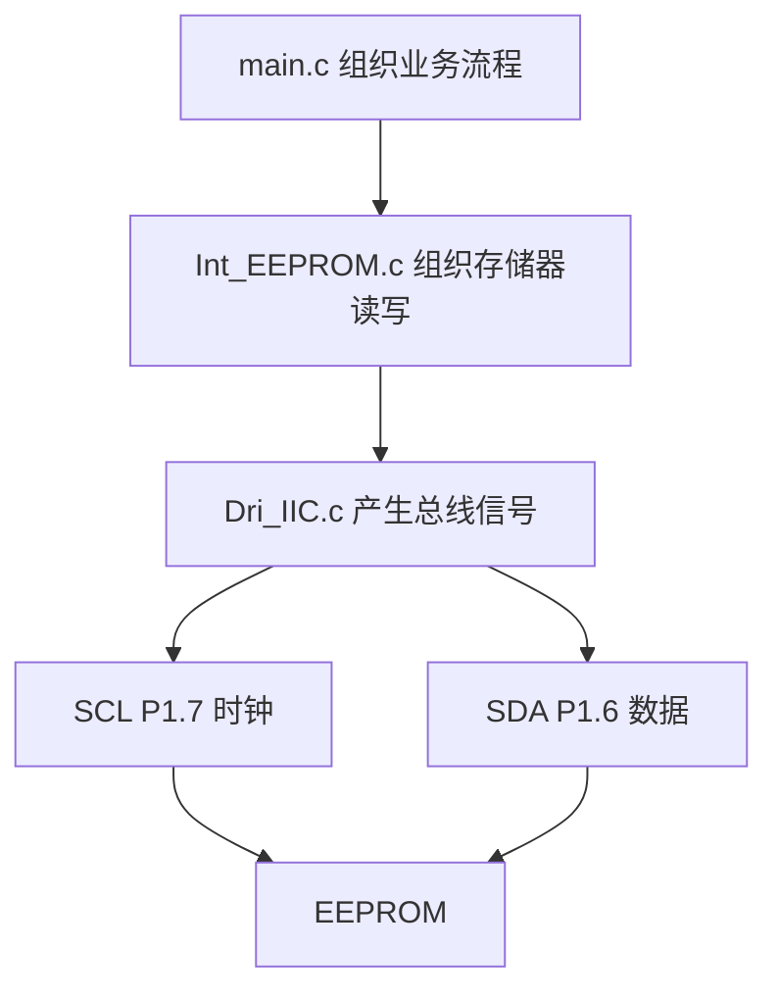
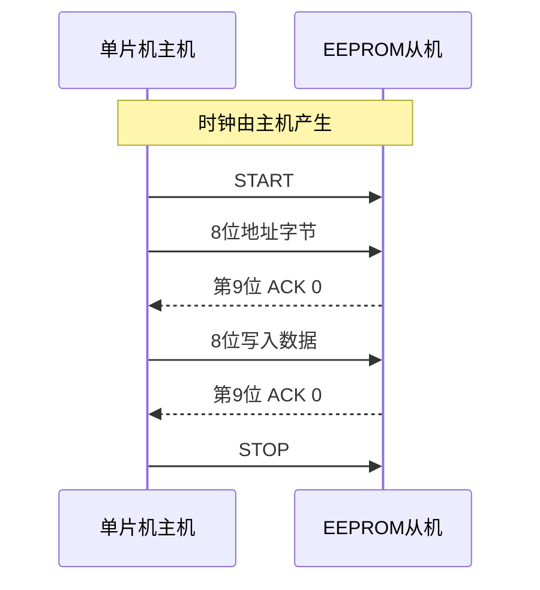

# IIC 软件驱动模块笔记

这份笔记对应当前工程的 `Dri_IIC.c` 和 `Dri_IIC.h`，结合课程 Word 中“I2C 协议基础”和“基础驱动编写”整理。目标是理解：单片机怎样通过两个 GPIO，完成起始、停止、发送字节、接收字节以及 ACK。

本文中的 IIC、I2C、I²C 指同一种总线。项目函数名沿用 `Dri_IIC_*`。

## 1 模块在项目中的位置



`Dri_IIC` 只负责总线基本动作，不知道 EEPROM 页大小，也不知道“尚硅谷”字模。EEPROM 的设备地址、存储地址、跨页写入规则属于上层 `Int_EEPROM`。

相关文件：

- [Dri_IIC.h](src/Dri/Dri_IIC.h)：引脚映射和对外函数声明。
- [Dri_IIC.c](src/Dri/Dri_IIC.c)：基本信号实现。
- [Util.h](src/Com/Util.h)：`u8` 等类型定义。
- [EEPROM 模块笔记](EEPROM模块笔记.md)：如何用这些基本动作访问 EEPROM。

## 2 两条线分别做什么

当前引脚定义：

```c
#define SCL P17
#define SDA P16
```

| 信号 | 当前引脚 | 作用 |
|---|---|---|
| SCL | P1.7 | 本项目中由主机产生时钟 |
| SDA | P1.6 | 双向数据线，主机和从机轮流控制 |

这里单片机是主机，EEPROM 是从机。写数据时主机控制 SDA；读数据时 EEPROM 控制 SDA。

I²C 通常采用开漏或开集输出配合上拉电阻：设备可以拉低总线，输出高电平实际上是释放总线，由上拉电阻使它变高。51 准双向口写 `1` 后才能让外设把引脚拉低；实际接线仍需检查上拉和电气条件，不能让主从双方用强推挽输出争抢电平。

所以：

```c
SDA = 1;
```

在接收数据或 ACK 前表示“释放 SDA”，并不是要求从机也发送 `1`。

## 3 最重要的时序规则

正常传输数据时：

- SCL 为低时，可以改变 SDA。
- SCL 为高时，SDA 应保持稳定，接收方在高电平期间读取。
- 每字节先发送最高位 bit7，再发送到最低位 bit0。
- 8 个数据位之后，还要有第 9 个时钟传输 ACK/NACK。

SCL 为高时 SDA 的特殊变化用于表示起始或停止。

| 状态 | SCL | SDA |
|---|---|---|
| 总线空闲 | 高 | 高 |
| START 起始 | 保持高 | 高变低 |
| STOP 停止 | 保持高 | 低变高 |
| ACK 确认 | 第 9 个时钟高电平 | 接收方拉低，读到 0 |
| NACK 不确认 | 第 9 个时钟高电平 | 接收方释放，读到 1 |

简化边沿图如下，横向表示时间：

```text
START：SCL  ──────────┐
                     └────
       SDA  ─────┐
                └─────────
                ↑ SCL 高时，SDA 下降

STOP： SCL  ____┌──────────
               │
       SDA  ________┌──────
                   │
                   ↑ SCL 高时，SDA 上升
```

以上是逻辑关系示意，不表示精确的脉宽和频率。

## 4 起始与停止

### 4.1 当前起始函数

```c
void Dri_IIC_Start()
{
    SCL = 1;
    SDA = 1;
    SDA = 0;
    SCL = 0;
}
```

先让两条线处于高电平，再在 SCL 为高时拉低 SDA，最后将 SCL 拉低，为后续发送准备。

在总线已经空闲时，这个过程容易理解。重复起始时则要留意原来的 SDA 状态：若 SDA 原本为低，先抬高 SCL、再抬高 SDA，会额外产生一个 STOP 边沿。因此更清晰的起始顺序是先在 SCL 低时释放 SDA，再抬高 SCL，最后拉低 SDA：

```c
/* 改进方向示意；实际还应满足器件的时序要求。 */
SCL = 0;
SDA = 1;
SCL = 1;
SDA = 0;
SCL = 0;
```

当前 EEPROM 随机读会连续调用两次 Start。这里是检查重复起始可靠性的重点，笔记中的改进示例并未修改项目源码。

### 4.2 当前停止函数

```c
void Dri_IIC_Stop()
{
    SDA = 0;
    SCL = 1;
    SDA = 1;
}
```

前一个基本动作通常让 SCL 停在低电平。先拉低 SDA，再拉高 SCL，最后在 SCL 高电平期间释放 SDA，就产生 STOP。STOP 后两条线为高，恢复空闲。

注意：“基本动作结束时 SCL 拉低”主要指字节收发和 ACK；Stop 结束后 SCL 应保持高，不能把这条习惯套到停止函数上。

## 5 发送一个字节

当前实现：

```c
void Dri_IIC_SendByte(u8 byte)
{
    u8 i;
    for (i = 0; i < 8; i++) {
        SDA = byte & (0x80 >> i);
        SCL = 1;
        SCL = 0;
    }
}
```

循环中的掩码依次为：

```text
i       0     1     2     3     4     5     6     7
掩码   0x80  0x40  0x20  0x10  0x08  0x04  0x02  0x01
取出   bit7  bit6  bit5  bit4  bit3  bit2  bit1  bit0
```

以 `0xA0` 为例：

```text
0xA0 = 1010 0000
发送顺序：1 → 0 → 1 → 0 → 0 → 0 → 0 → 0
```

每轮先设置 SDA，再让 SCL 变高供从机采样，最后拉低 SCL，准备下一位。

Word 示例把取位结果显式转换成 0 或 1：

```c
SDA = (byte & (0x80 >> i)) == 0 ? 0 : 1;
```

当前 `SDA` 映射到 C51 的 `sbit`，赋值按逻辑零/非零处理。为了让意图更明确，也可以写：

```c
SDA = (byte & (0x80 >> i)) != 0;
```

若左边是普通 `u8` 变量，直接掩码赋值可能保存 `0x80`、`0x40` 等，不能把它们都当作数值 `1`。

**SendByte 只发送 8 位，不包含第 9 位 ACK。** 上层一般接着调用 `Dri_IIC_ReceiveAck()`。

## 6 接收 ACK

```c
bit Dri_IIC_ReceiveAck()
{
    bit ack;
    SDA = 1;
    SCL = 1;
    ack = SDA;
    SCL = 0;
    return ack;
}
```

主机刚发送完一个字节，现在应由接收方回复。主机先释放 SDA，然后产生第 9 个时钟并读取 SDA。

| 返回值 | 含义 |
|---|---|
| `0` | ACK，接收方确认 |
| `1` | NACK，接收方未确认或不再接收 |

这里 `bit` 是 Keil C51 的扩展类型，只保存 0 或 1。变量叫 `ack`，但返回的是实际 SDA 电平，**不是“1 表示成功”**。

```c
if (Dri_IIC_ReceiveAck() != 0) {
    /* 收到了 NACK，应结束或重试。 */
}
```

ACK 表示这一字节被确认，不等于 EEPROM 已完成内部非易失写入。

## 7 接收一个字节

你当前已修正为：

```c
u8 Dri_IIC_ReceiveByte()
{
    u8 byte = 0;
    u8 i;
    SDA = 1;
    for (i = 0; i < 8; i++) {
        SCL = 1;
        byte = (byte << 1) | SDA;
        SCL = 0;
    }
    return byte;
}
```

主机释放 SDA，由 EEPROM 给出每一位。主机产生时钟，在 SCL 高电平期间采样。

`byte << 1` 将已有数据向左移动，最低位腾出位置；`| SDA` 把新收到的位放进 bit0。循环 8 次后，先收到的位就到了 bit7。

例如接收 `1010 1010`：

```text
收到位     累积结果
1          0000 0001
0          0000 0010
1          0000 0101
0          0000 1010
1          0001 0101
0          0010 1010
1          0101 0101
0          1010 1010
```

曾经的错误写法是：

```c
byte |= (byte << 1) | SDA;
```

它相当于 `byte = byte | (byte << 1) | SDA`，把旧位置的 1 也保留下来，破坏了移位累积的结果。

**ReceiveByte 也只有 8 个时钟。** 接收后由主机调用 SendAck，完成第 9 个时钟。

## 8 发送 ACK 与 NACK

```c
void Dri_IIC_SendAck(bit ack)
{
    SDA = ack;
    SCL = 1;
    SCL = 0;
}
```

主机读取数据后，是主机作为接收方发出确认：

```c
Dri_IIC_SendAck(0); // ACK：继续接收
Dri_IIC_SendAck(1); // NACK：最后一字节，不再继续接收
```

SendAck 传一位，SendByte 传八位，两者不能互换：

```c
Dri_IIC_SendByte(1); // 发的是 0000 0001，不是一个 NACK
```

## 9 谁发送数据 谁回复确认

| 当前动作 | 8 位数据发送方 | 第 9 位确认发送方 | 主机调用 |
|---|---|---|---|
| 主机向 EEPROM 发设备地址 | 主机 | EEPROM | SendByte → ReceiveAck |
| 主机写存储地址或数据 | 主机 | EEPROM | SendByte → ReceiveAck |
| 主机读取 EEPROM 数据 | EEPROM | 主机 | ReceiveByte → SendAck |



## 10 设备地址与读写位

通常的 7 位 I²C 地址与总线上发出的地址字节不同：

```text
地址字节 = 7位设备地址左移1位 | 读写位
```

本项目 `DEV_ADDR = 0xA0` 已经是带写标志的地址字节：

```text
0xA0 = 1010 0000 → 7位地址 0x50，写位 0
0xA1 = 1010 0001 → 7位地址 0x50，读位 1
```

软件模拟驱动直接发送 `0xA0` 或 `0xA1`。若换用其他硬件库，接口可能要求传 `0x50`，不能不看接口约定就照搬。

“高四位固定、后三位选择设备”是课程中这类 EEPROM 的寻址格式，不是所有 I²C 设备的通用规则。地址引脚及保留位应查实际器件手册。

## 11 当前实现的适用范围

当前是教学用 GPIO 模拟 I²C，没有显式时序延时、SCL 拉高后的实际电平检查、超时或总线恢复逻辑。不同 CPU 频率、编译优化和负载会改变实际总线速度，不能仅凭代码断言符合某个速率。

进一步完善时可以依次检查：

1. 上拉电阻、共地、SDA/SCL 接线和设备供电。
2. 起始、重复起始、数据建立时间和时钟高低时间。
3. 每个 ACK 是否实际为 0。
4. 是否需要处理时钟延展及等待超时。
5. 中断是否只会延长 SCL 脉宽，是否有其他代码同时操作这些引脚。

不要让主循环和中断同时发起 I²C 事务，否则两段时序会混在一起。当前 EEPROM 读写应在主循环执行，点阵中断只负责显示扫描。

## 12 本次学习检查表

- [ ] 能说明 START 与 STOP 都是在 SCL 高时改变 SDA。
- [ ] 能说明 8 个数据位之后为什么还有第 9 个时钟。
- [ ] 能区分 ReceiveAck 与 SendAck。
- [ ] 知道 ACK 为 0，NACK 为 1。
- [ ] 接收累积使用 `=`，不能误用 `|=`。
- [ ] 知道 `0xA0` 是地址字节，`0x50` 是对应的 7 位地址。

## 参考

- 当前项目：[Dri_IIC.c](src/Dri/Dri_IIC.c)、[Dri_IIC.h](src/Dri/Dri_IIC.h)。
- 尚硅谷研究院《尚硅谷嵌入式技术之51单片机》V2.1.0，章节“I2C 协议基础”“基础驱动编写”。源文档位于 `C:\Users\stan0930\Desktop\07_尚硅谷嵌入式技术之51单片机\1.笔记\尚硅谷嵌入式技术之51单片机2.1.0.docx`。

Mermaid 图可在支持 Mermaid 的 Markdown 阅读器中查看；代码和文字在普通 Markdown 阅读器中也可阅读。
