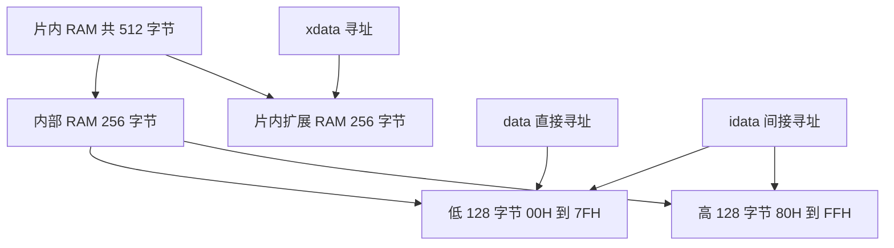

# 51 单片机存储器笔记

这份笔记解释 RAM、ROM、Flash，以及 Keil C51 中 `data`、`idata`、`xdata`、`code` 的关系，并结合本工程的内存溢出和配置修改说明如何分配变量。

容量以课程使用的 **STC89C52RC：512 字节 RAM、8 KB 程序 Flash** 为例。其他 51 型号的容量可能不同，不能只看到“51”就套用这些数值。代码语法以当前工程使用的 Keil C51 为准。

## 1 先分清硬件和 C 语言关键字

| 名称 | 是什么 | 通常存什么 | 断电后 |
| --- | --- | --- | --- |
| RAM | 可读写的工作存储器 | 变量、接收缓冲、显示缓冲、栈 | 数据丢失 |
| ROM | 只读程序存储器的传统称呼 | 程序、固定数据 | 数据保留 |
| Flash | 可擦写的非易失存储器，本芯片用它保存程序 | 程序指令、字模、段码 | 数据保留 |
| `data` | C51 存储区关键字 | 指定对象使用内部 RAM 直接寻址区 | 随 RAM 丢失 |
| `idata` | C51 存储区关键字 | 指定对象使用内部 RAM 间接寻址区 | 随 RAM 丢失 |
| `xdata` | C51 存储区关键字 | 指定对象使用外部数据寻址空间 | 本例对应片内扩展 RAM，断电丢失 |
| `code` | C51 存储区关键字 | 指定数据放在程序存储空间 | 本例对应 Flash，断电保留 |

RAM、Flash 是硬件存储器；`data`、`idata`、`xdata`、`code` 告诉编译器把对象放在哪里、使用哪种指令访问。

本芯片程序存储器实际是 Flash。资料里写的“ROM 区”“程序区”“CODE 区”，在普通编程语境下经常指向这块程序存储空间。

## 2 512 字节 RAM 到底怎么分

物理容量的分法是：

```text
STC89C52RC 的 512 字节 RAM
│
├── 内部 RAM：256 字节
│   ├── 低 128 字节：00H～7FH
│   │   ├── 可以用 data 直接访问
│   │   └── 也可以用 idata 间接访问
│   │
│   └── 高 128 字节：80H～FFH
│       └── 用 idata 间接访问
│
└── 片内扩展 RAM：256 字节
    └── 用 xdata 访问，地址 0000H～00FFH
```

**容量上是 128 + 128 + 256 = 512，但不能把它记成三个互不重叠的 data、idata、xdata 区。**

`idata` 能覆盖内部整个 256 字节，其中包含 `data` 对应的低 128 字节。



支持 Mermaid 的 Markdown 预览可以显示流程图；上面的文本图表达相同关系。

### 相同地址不一定是同一块存储器

内部高 128 字节 RAM 和特殊功能寄存器 SFR 都使用 `80H～FFH` 这样的地址编号，但访问方式不同：

```text
80H～FFH 的直接寻址  → SFR，例如 P0、P1、TMOD
80H～FFH 的间接寻址  → 内部高 128 字节 RAM
```

因此，高 128 字节 RAM 没有被 P0、P1 等寄存器占掉。SFR 也不作为普通数组 RAM 加入上述 512 字节。

同理，XDATA 地址 `0000H` 和内部 RAM 地址 `00H` 属于不同寻址空间，可以同时存在，不能只看地址数字判断是否冲突。

## 3 data 放什么

`data` 使用内部低 128 字节，访问快，适合小变量。

```c
unsigned char data key;
unsigned char data index;
unsigned int data counter;
```

内部低 128 字节还包括寄存器组、位寻址区等。不能认为可以额外定义一个 `data array[128]`，然后还剩空间给其他变量。

当变量、参数和其他 DATA 分配挤满低 128 字节时，即使芯片总 RAM 还剩很多，也会出现 DATA 溢出。

## 4 idata 放什么

`idata` 使用内部 RAM 的间接寻址方式，可以利用高 128 字节。

```c
unsigned char idata work_buffer[64];
```

注意两点：

- 写 `idata` 并不保证从 `80H` 开始放。它也可能占用低地址，具体由链接器安排。
- DATA 与 IDATA 对象合起来占内部 256 字节，此外还要给栈、中断等留空间。

不要把 `idata` 理解成“DATA 满了以后自动扩展的另一个 128 字节池”。必须通过声明和链接布局来使用它。

## 5 xdata 放什么

`xdata` 使用外部数据寻址空间，适合较大的可写数组、字符串、接收缓冲等。

```c
char xdata str[32];
unsigned char xdata receive_buffer[128];
```

这里“外部”描述的是 **8051 的寻址方式**。STC89C52RC 把其中 256 字节 RAM 做在芯片内部，使用这一部分不需要外接 RAM 芯片。

本芯片片内扩展 RAM 对应的范围是 `0000H～00FFH`。经典 XDATA 寻址空间可以到 64 KB，但那是地址空间，不代表你的芯片实际有 64 KB RAM。

实际使用时需确认片内扩展 RAM 的控制设置没有将其禁用。编译器能生成 `xdata` 访问代码，不等于它已经检查了硬件启用状态或实物容量。

## 6 code 放什么

`code` 将固定数据放进程序 Flash，适合不需要修改的段码、字模、查找表。

```c
unsigned char code digit_codes[10] = {
    0x3F, 0x06, 0x5B, 0x4F, 0x66,
    0x6D, 0x7D, 0x07, 0x7F, 0x6F
};
```

这张表占程序 Flash，不占那 512 字节 RAM。本工程的 OLED 字库已经使用 `code`：

```c
code const u8 Int_OLED_Font[][16] = {
    /* 字模数据 */
};
```

普通 C 赋值不能把它当作可写 RAM：

```c
/* 不应这样写 */
digit_codes[0] = 0x00;
```

Flash 的特殊擦写需要芯片支持的专门流程，不是普通变量赋值。

`sprintf` 的输出缓冲区、串口接收数组都需要修改，不能为了省 RAM 把它们放到 `code`。

## 7 const 和 static 不能替代存储区关键字

| 声明中的词 | 表达的含义 | 会不会自动把对象搬进 Flash |
| --- | --- | --- |
| `const` | 限制通过相应表达式修改对象 | 不能仅凭这个词保证 |
| `static` | 控制存储期或作用域 | 不会 |
| `code` | 明确指定程序存储区 | 会将该数据放进程序空间 |
| `idata` / `xdata` | 明确指定相应 RAM 区域 | 不会，仍是 RAM |

例如，固定表建议明确写：

```c
static const unsigned char code table[4] = {1, 2, 3, 4};
```

不要只给大数组加 `static`，就以为解决了 DATA 溢出。存放区域仍取决于显式声明或默认内存模型。

## 8 SMALL 和 LARGE 配置影响什么

### 在哪个配置文件中修改

本工程使用 VS Code 的 EIDE 插件，配置文件是项目根目录下的 [.eide/eide.yml](../.eide/eide.yml)。当前构建目标为 `Debug`，工具链为 `Keil_C51`，对应设置位置是：

```text
targets
└── Debug
    └── toolchainConfigMap
        └── Keil_C51
            └── options
                └── global
                    ├── ram-mode
                    └── rom-mode
```

在现有文件中找到这个 `global` 块，修改对应字段即可。不要将下面的节选直接追加到文件末尾，也不要改到另一个工具链的设置中。

本工程当前配置是：

```yaml
global:
  ram-mode: LARGE
  rom-mode: LARGE
```

这两个 LARGE 控制不同的事情。

### 从 SMALL 改为 LARGE 怎么操作

修改前：

```yaml
global:
  ram-mode: SMALL
  rom-mode: LARGE
```

修改后：

```yaml
global:
  ram-mode: LARGE
  rom-mode: LARGE
```

这次只改 `ram-mode`。保留原来的缩进，YAML 使用空格缩进，不要混入 Tab。改回 SMALL 时，只需把同一字段的值恢复为 `SMALL`。

### 一段声明在两种模式下有什么不同

```c
char str[32];
```

```text
ram-mode: SMALL → str 默认放 DATA，消耗低128字节空间
ram-mode: LARGE → str 默认放 XDATA，消耗片内扩展RAM空间
```

如果明确指定区域，切换模式不会改变该对象的存储区：

```c
char xdata str[32];  /* SMALL、LARGE 下都放 XDATA */
char idata buf[32];  /* SMALL、LARGE 下都放 IDATA */
```

### ram-mode 是变量的默认内存模型

| 内存模型 | 普通未注明存储区的变量默认放哪里 |
| --- | --- |
| `SMALL` | DATA |
| `COMPACT` | PDATA，即分页访问的外部数据空间 |
| `LARGE` | XDATA |

这里讨论的是需要分配内存的普通对象，实际优化还可能使用寄存器等。显式写出的存储区优先于默认模型：

```c
/* 当前 LARGE 模型下 */
char str[32];                   /* 默认使用 XDATA */
unsigned char data count;       /* 仍使用 DATA */
unsigned char idata cache[32];  /* 仍使用 IDATA */
unsigned char code lut[4] = {0, 1, 2, 3}; /* 仍使用 CODE */
```

`COMPACT` 不会提供额外 RAM。分页访问及相关端口、页选择还需要按具体硬件处理，不建议把它当作本工程内存不足时的随意替代选项。

**没有一个配置能把这 512 字节变成编译器自动均衡使用的统一 RAM 池。** 改为 LARGE 只是让默认分配转向 XDATA，XDATA 满后仍要主动调整对象的存放区域。

### rom-mode 是程序代码模型

`rom-mode: LARGE` 对应编译器的 `ROM(LARGE)`，影响程序代码布局及调用方式。它不会增加 Flash 容量，也不会让变量自动搬到 RAM 的其他区域。

```text
ram-mode → 普通变量默认放哪里
rom-mode → 程序代码模型
芯片型号 → 实际有多少 RAM 和 Flash
```

### 改内存模型后要重新构建

1. 保存 `.eide/eide.yml`。
2. 在 EIDE 中执行“重新构建 / Rebuild”，重新编译所有源文件，让各模块使用一致的模型。
3. 检查编译命令和新生成的 `build/Debug/template.map`。
4. 确认内存分配没有超出实物容量，再上板验证。

编译命令中的两种选项可以这样识别：

```text
... SMALL ROM(LARGE) ...  → RAM 默认模型为 SMALL
... LARGE ROM(LARGE) ...  → RAM 默认模型为 LARGE
```

`.map` 中应该能查到：

```text
MEMORY MODEL: LARGE
```

再查 `str` 的分配记录，确认其 `MEMORY CLASS` 为 `XDATA`。汇总中的 `data=` 通常减少、`xdata=` 增加，但具体数字随代码变化，以当次映射为准。

不要直接编辑 `build/Debug/builder.params` 或 `template.lnp` 来保存这项设置：它们是构建生成文件，可能被 EIDE 重新生成覆盖。工程的持久配置应改在 `.eide/eide.yml`。

本文件也有 SDCC 的 `--iram-size`、`--xram-size` 等选项，但当前使用的是 Keil C51，修改那些 SDCC 选项不会解决当前 Keil 的 DATA 溢出。`rom-mode` 同样不能解决这个问题。

### 切换模型后仍要检查容量和时序

LARGE 不会提供更多物理 RAM，也不会在 XDATA 满后自动转入 IDATA。本芯片片内扩展 RAM 仍是 256 字节；较大的可写对象可用 XDATA，小对象按需要显式用 DATA 或 IDATA 分担，固定表继续用 CODE。

访问 XDATA 通常比 DATA 开销大。靠循环次数产生的软件延时，可能因模型变化而改变耗时。本工程部分微秒延时变量已经明确声明为 `data`，但其他延时和总线功能仍需要结合实际编译结果、晶振和上板运行确认。

## 9 为什么 char str[32] 会导致链接失败

之前使用 SMALL 模型：

```c
char str[32];
```

这 32 字节进入 DATA，和其他模块的缓冲区、状态、参数等争用低 128 字节。

```text
*** ERROR L107: ADDRESS SPACE OVERFLOW
    SPACE: DATA
```

它表达的是“DATA 分配不下”，并不是“整个 512 字节 RAM 都用完了”。单个 DATA 段过大时，也可能在编译阶段报告 `DATA: SEGMENT TOO LARGE`。

可以采用以下方式之一：

```c
/* 方法一：SMALL 模型下，单独把缓冲放到扩展 RAM */
char xdata str[32];

/* 方法二：显式使用内部间接寻址 RAM */
char idata str[32];

/* 方法三：项目改用 LARGE，普通声明默认进入 XDATA */
char str[32];
```

这些是替代方案，不是同时定义三个同名数组。

报错指向 `INT_MATRIXLED` 或 `INT_DIGITALTUBE`，表示链接器分配到这些段时空间不够，并不说明这两个模块就是根因。本工程映射中，未使用模块的部分静态数据段仍参与了分配，不能假定 `REMOVEUNUSED` 会删除所有不需要的 RAM 数据。

## 10 怎么看 Program Size

本工程此前 SMALL 模型链接失败时：

```text
Program Size: data=142.4 xdata=0 const=1605 code=3233
```

| 输出项 | 这里表示什么 | 应与什么容量比较 |
| --- | --- | --- |
| `data=142.4` | 内部数据使用统计，142 字节另 4 个位 | 结合 DATA、IDATA、BIT 映射判断 |
| `xdata=0` | XDATA 使用量 | 实际可用的扩展 RAM |
| `const=1605` | 当前 LX51 输出中单列的只读常量 | 程序 Flash |
| `code=3233` | 当前输出中的程序代码 | 程序 Flash |

`142.4` 不是十进制的 142.4 字节，`.4` 是 4 个位。

汇总中的 `data=` 不能一律当成“直接 DATA 区占用”。显式使用 IDATA 后，内部数据总量超过 128 也可能链接成功。**具体是哪一区溢出，看报错的 SPACE 和 `.map` 的 MEMORY CLASS。**

当前改成 LARGE 后，使用同一批源代码试编译、链接得到：

```text
Program Size: data=15.4 xdata=152 const=1605 code=3584
```

这说明普通对象已经大量转移到 XDATA，消除了原来的 DATA 溢出。模型变化后，访问代码和库实现也可能变化，所以 CODE 大小不一定保持不变。

按当前 LX51 报告的分项，程序与只读常量合计是：

```text
3584 + 1605 = 5189 字节
```

这一合计与本芯片的 8192 字节程序 Flash 比较，不能与 512 字节 RAM 比较。若换用其他工具或报告格式，先确认 `const` 是否已包含在 `code` 统计里，避免重复计算。

## 11 怎么用 map 判断还有多少空间

本工程链接映射文件位于：

```text
build/Debug/template.map
```

优先搜索以下关键词：

| 关键词 | 用途 |
| --- | --- |
| `MEMORY MODEL` | 确认实际使用 SMALL 还是 LARGE |
| `DATA MEMORY`、`MEMORY CLASS` | 查看 DATA、IDATA、XDATA 的地址和长度 |
| `str` | 查字符串数组实际分配到了哪里 |
| `?STACK` | 查内部硬件栈的起始位置 |
| `ADDRESS SPACE OVERFLOW` | 查溢出的区域和段 |

检查要点：

- DATA 分配不能超出低 128 字节。
- DATA、IDATA、位数据及栈等共同使用内部 RAM，不能各自按独立容量算。
- 本芯片片内 XDATA 分配应落在 `0000H～00FFH`，还要确认硬件允许访问片内扩展 RAM。
- `.map` 中 `?STACK` 可能只显示很小的保留长度，例如 1 字节。这不是运行时最多只用 1 字节栈；函数调用、中断保存现场会继续占用内部 RAM。

链接通过只能说明静态布局满足链接器的规则，不能保证运行时不会栈溢出，也不能保证链接器设置的地址范围与实物容量完全相符。

## 12 本工程推荐的分配方式

当前 LARGE 模型下，可以这样搭配：

```c
/* 经常使用的小状态，显式放 DATA */
unsigned char data page;
unsigned char data key;

/* 工作缓冲，利用内部 RAM */
unsigned char idata display_buffer[8];

/* 字符串和大缓冲，使用片内扩展 RAM */
char xdata str[32];
unsigned char xdata receive_buffer[64];

/* 固定表，放程序 Flash */
const unsigned char code digit_codes[10] = {
    0x3F, 0x06, 0x5B, 0x4F, 0x66,
    0x6D, 0x7D, 0x07, 0x7F, 0x6F
};
```

这些声明只是分配示例，是否放得下仍需结合完整工程。中断与主程序共享的数据还要按需要添加 `volatile`，多字节读写的原子性也需要单独处理；存储区关键字不会解决同步问题。

### 数组搬区后，函数参数要匹配

C51 中普通通用指针可以表示多个存储区，而专用指针限定了所指数据所在的区域：

```c
void Show(char *p);           /* 通用指针，可以接收不同存储区的字符数据 */
void ReadRam(char xdata *p);  /* 专用于指向 XDATA 中的字符 */
```

如果已有函数声明是 `char data *p`，不要直接当作它可以正确访问 XDATA 数组。应按用途调整声明与定义，或使用合适的通用指针。读 `code` 表时，也不能让后续函数把它当作可写缓冲区。

### 不要按 PC 的栈习惯理解普通局部数组

标准 C51 的非重入函数通常为参数、局部变量安排静态存储位置，并对允许的调用关系做覆盖分配；普通局部数组不一定像 PC 程序那样临时放到调用栈上。

因此，把大数组挪进某个函数里，不一定减少 RAM 占用或解决 DATA 溢出。应看存储区、调用关系和链接映射，而不是只看变量写在大括号内还是外。

## 13 考前速记

```text
RAM：运行时可写，断电丢失。
Flash：保存程序和固定数据，断电保留。

data：内部低 128 字节，直接寻址。
idata：内部全部 256 字节，间接寻址，与 data 重叠。
xdata：外部数据寻址方式，本芯片有 256 字节片内扩展 RAM。
code：程序存储空间，固定表放这里可省 RAM。

SMALL：普通变量默认进 DATA。
LARGE：普通变量默认进 XDATA。
显式的 data、idata、xdata、code 优先于默认模型。

512 字节 RAM 不含程序 Flash。
有空余总容量，不代表某个具体区域一定放得下。
内部 RAM 还要留栈空间，不能拿满 256 字节定义数组。
```

工程对照：[配置](../.eide/eide.yml)、[当前 main](../src/main.c)、[软件延时](../src/Com/Util.c)、[OLED 字库](../src/Int/Int_OLED.c)、[数码管练习](decimal_signed_demo.c)。文中编译数值来自本次对话期间的实际构建；以后修改源代码后，应以最新生成的 `.map` 为准。
