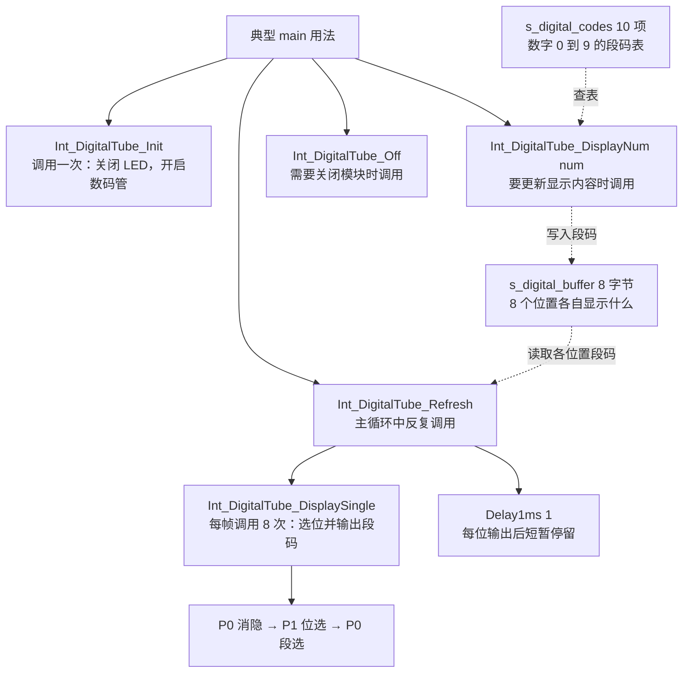
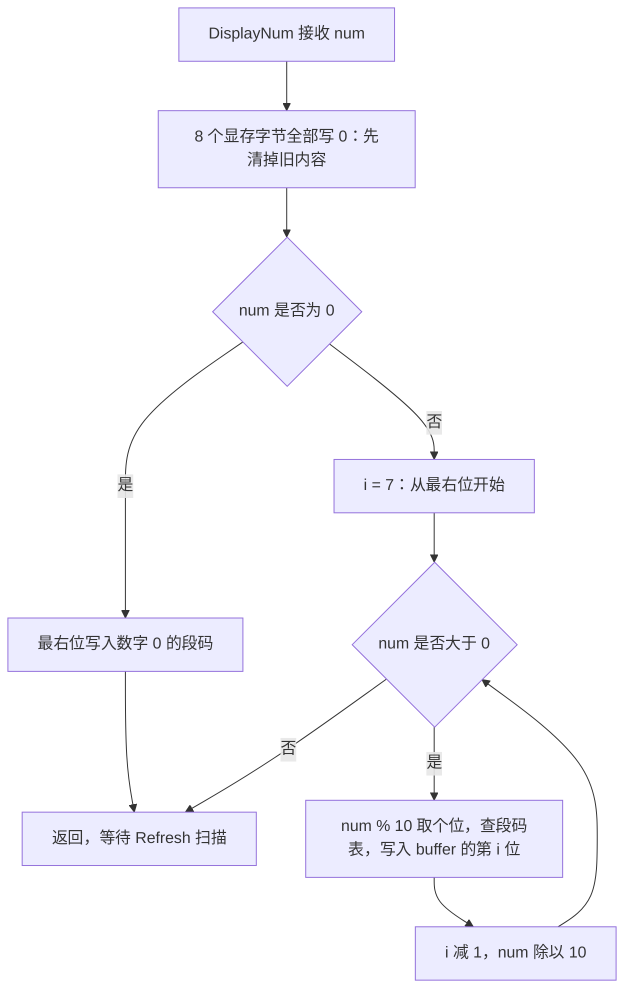
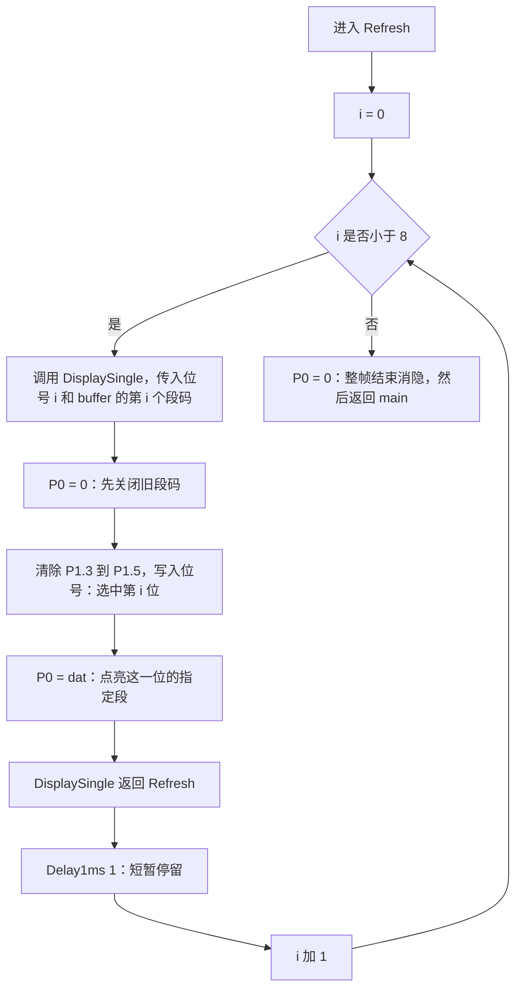

# 数码管模块设计与调用图

这份笔记按照当前 `src/Int/Int_DigitalTube.c` 和 `.h` 梳理，帮助回忆这个模块的设计、main 中的用法，以及函数之间的调用关系。

**一句话回忆：Init 开硬件，DisplayNum 把数字变成段码存入显存，Refresh 反复扫描显存，DisplaySingle 负责实际操作引脚。**

当前 `src/main.c` 运行的是 OLED 时钟，没有调用数码管。下面的 main 是数码管模块的典型使用示例，不是当前 main 的运行路径；也不是另一个定时器扫描练习 `decimal_signed_demo.c` 的设计。

## 1 这种图叫什么

| 想回忆什么 | 图的名称 | 看什么关系 |
| --- | --- | --- |
| 为了完成显示，main 应该先后做什么 | 程序流程图 | 初始化、设置数据、循环刷新 |
| 哪个函数调用哪个函数 | 函数调用关系图，也叫调用图 | main 调用公开接口，Refresh 调用内部函数 |
| 数字怎么变成引脚输出 | 数据流图 | 数值 → 段码 → 显存 → P0 |
| 为什么把代码拆成这些函数和文件 | 模块设计图 | 外部接口、内部实现、共享状态、依赖 |

你需要的是“**模块设计图 + 函数调用关系图**”，再配关键函数的流程图。只画普通流程图，不一定能同时说明代码怎样拆分、函数怎样协作。

## 2 一眼回忆整个模块

下图的实线表示函数调用，虚线表示数据读写。



图中同一个 main 指向多个接口，表示“使用模块时可能调用哪些函数”，不表示它们并行执行。具体先后顺序看下一节。

显存和段码表都不是函数。`DisplayNum()` 和 `Refresh()` **通过显存交换数据，不互相调用**。

## 3 main 中到底要写什么

```c
#include "Int_DigitalTube.h"

void main(void)
{
    Int_DigitalTube_Init();
    Int_DigitalTube_DisplayNum(12345UL);

    while (1) {
        Int_DigitalTube_Refresh();
    }
}
```

运行顺序：

```text
程序开始
    ↓
Init：打开数码管硬件
    ↓
DisplayNum(12345)：准备好 8 位段码
    ↓
进入 while (1)
    ↓
Refresh：依次扫描 0～7 位
    ↓
回到 while (1)，继续 Refresh
```

| 要完成的任务 | main 应该调用什么 | 调用时机 |
| --- | --- | --- |
| 开启数码管 | `Int_DigitalTube_Init()` | 使用模块前调用一次 |
| 改成显示另一个数 | `Int_DigitalTube_DisplayNum(num)` | 数值变化时调用 |
| 让多位数字持续可见 | `Int_DigitalTube_Refresh()` | 在主循环中不断调用 |
| 关闭数码管 | `Int_DigitalTube_Off()` | 不再显示或切换模块时 |

`DisplayNum()` 不必每次循环都调用；显示值没变时，反复刷新同一份显存即可。关闭模块后，应停止该模式的刷新；再次开启时，如需更换内容，要重新设置数值。

### 声明、定义、调用有什么区别

```c
/* .h 中：声明，告诉编译器这个函数的名字、参数和返回类型 */
void Int_DigitalTube_DisplayNum(u32 num);

/* .c 中：定义，写出函数真正要做的事 */
void Int_DigitalTube_DisplayNum(u32 num)
{
    /* 拆位、查表、写显存 */
}

/* main 中：调用，让函数现在执行 */
Int_DigitalTube_DisplayNum(12345UL);
```

main 通常通过 `#include "Int_DigitalTube.h"` 获得声明，不需要把这些声明再抄一遍。工程还必须编译、链接 `Int_DigitalTube.c`，否则只有声明，没有函数实现。

## 4 谁调用谁

```text
典型 main
├── Int_DigitalTube_Init()
│   ├── LED_EN = 0
│   └── SMG_EN = 0
│
├── Int_DigitalTube_DisplayNum(num)
│   └── 清显存、拆位、查表、写显存，不调用扫描函数
│
├── while (1)
│   └── Int_DigitalTube_Refresh()
│       ├── 循环 i = 0～7
│       │   ├── Int_DigitalTube_DisplaySingle(i, buffer[i])
│       │   │   ├── P0 = 0：消隐
│       │   │   ├── 修改 P1.3～P1.5：选位
│       │   │   └── P0 = dat：输出段码
│       │   └── Delay1ms(1)：保持当前位点亮一小段时间
│       └── P0 = 0：一帧结束后消隐
│
└── Int_DigitalTube_Off()，退出显示模式时使用
    ├── P0 = 0
    └── SMG_EN = 1
```

`LED_EN`、`SMG_EN` 是引脚宏，赋值是直接操作硬件，不是调用其他函数。

## 5 为什么设计一个显存数组

```c
static u8 s_digital_buffer[8];
```

这里的“显存”是自己在单片机 RAM 里定义的数组，用来记住每个位置的段码。它不是显示屏自带的存储器。

有了显存，可以把两件事分开：

- **内容处理**：要显示哪个数、怎样拆位、要不要补零或符号。
- **硬件扫描**：依次选中各位，把该位置的段码写到引脚。

例如调用 `Int_DigitalTube_DisplayNum(12345UL)` 后：

| 显存下标 | 0 | 1 | 2 | 3 | 4 | 5 | 6 | 7 |
| --- | --- | --- | --- | --- | --- | --- | --- | --- |
| 位置 | 最左位 | 第2位 | 第3位 | 第4位 | 第5位 | 第6位 | 第7位 | 最右位 |
| 段码 | `0x00` | `0x00` | `0x00` | `0x06` | `0x5B` | `0x4F` | `0x66` | `0x6D` |
| 内容 | 空白 | 空白 | 空白 | 1 | 2 | 3 | 4 | 5 |

注意：数组里存的是**段码**，不是数字本身，也不是字符 `'1'`、`'2'`。

## 6 DisplayNum 的流程

当前函数只接收无符号整数，主要做以下事情：



用 `12345` 走一遍：

```text
12345 % 10 = 5 → 查表得 0x6D → buffer[7]
 1234 % 10 = 4 → 查表得 0x66 → buffer[6]
  123 % 10 = 3 → 查表得 0x4F → buffer[5]
   12 % 10 = 2 → 查表得 0x5B → buffer[4]
    1 % 10 = 1 → 查表得 0x06 → buffer[3]
```

为什么先清显存？如果上次显示 `12345`，这次只显示 `67`，不清理就可能残留左边的旧数字。

为什么单独处理 0？因为 `while (num > 0)` 在输入为 0 时一次都不执行，不补这一分支就会全空白。

为什么从下标 7 开始？先拆出来的是个位，把它放在最右边，就自然得到右对齐显示。

## 7 Refresh 和 DisplaySingle 的流程



关键引脚操作来自当前源码：

```c
P0 = 0;
P1 &= 0xC7;
dig <<= 3;
P1 |= dig;
P0 = dat;
```

| 操作 | 原因 |
| --- | --- |
| 先 `P0 = 0` | 切换位号前消隐，避免旧段码出现在新位置产生重影 |
| `P1 &= 0xC7` | 清除 P1.3～P1.5 的旧位号，保留其他位的锁存状态 |
| `dig <<= 3` | 将 0～7 的三位位号移动到 P1.3～P1.5 |
| `P1 |= dig` | 写入新的位号，交给译码器选择数码管位置 |
| `P0 = dat` | 输出该位置的段码 |
| `Delay1ms(1)` | 让该位维持点亮，避免扫描过快导致亮度太低 |

同一时刻只点亮一位，快速重复扫描后，视觉上就像多位同时点亮。主循环必须持续刷新；如果中间阻塞很久，显示会暗下来或闪烁。

一帧包含 8 次延时，名义上约 8 ms 加函数和循环开销。实际时间受晶振、编译优化和内存模型影响；本工程现在为 LARGE，不能只凭函数名认定延时绝对精确。

## 8 文件怎样分工

| 文件或对象 | 职责 | main 是否需要直接操作 |
| --- | --- | --- |
| `Int_DigitalTube.h` | 声明 4 个公开函数，提供使用入口 | include 它，然后调用接口 |
| `Int_DigitalTube.c` | 定义公开函数、内部函数和数组 | 交给工程编译链接，不直接 include `.c` |
| `s_digital_codes` | 固定数字段码表，存放在 CODE 区 | 不需要 |
| `s_digital_buffer` | 保存每个位置即将输出的段码 | 不需要，由 DisplayNum 和 Refresh 使用 |
| `DisplaySingle` | 内部硬件操作细节，文件级 static 函数 | 不应直接调用 |
| `Util.h` / `Util.c` | 提供 u8、u32 类型和 Delay1ms 声明、实现 | 本模块依赖它们 |

文件级 `static` 把内部名字限制在本 `.c` 文件内。main 只接触“初始化、设内容、刷新、关闭”四个接口，不需要知道位选细节。

源码对照：[数码管实现](../src/Int/Int_DigitalTube.c)、[数码管头文件](../src/Int/Int_DigitalTube.h)、[延时实现](../src/Com/Util.c)。

本工程还有一条已有的使用路径：`Int_MatrixKey_Init()` 开启数码管，`Int_MatrixKey_Refresh()` 读到按键后设置显示值并刷新；等待松手的循环也调用刷新，避免长按时停刷。它是矩阵按键模块对数码管的调用，不是当前 main 已经在使用这条路径。

## 9 用这张设计图思考考试改题

| 新任务 | 优先修改哪里 | 为什么 |
| --- | --- | --- |
| 显示负数、小数 | DisplayNum 的格式化逻辑和接口 | 变化的是每个位置放什么段码 |
| 显示 `12-34` 等格式 | 内容生成逻辑或新增格式接口 | 中间某个位置需要负号段码，不是普通拆整数 |
| 按键改变显示值 | main 或上层按键业务 | 有新值时调用设置接口，刷新继续执行 |
| 消除等待测温时的闪烁 | 扫描调度方式 | 需要保持刷新，不能长时间停在其他任务 |
| 改成定时器扫描 | 将扫描改成每次只处理一位 | 原 Refresh 包含 8 次延时，不能原样塞进 1 ms 中断 |

当前源码有两点边界要记住：

- `DisplayNum(u32)` 是无符号整数接口，不支持直接传负数或小数。
- 拆位循环没有检查下标是否越界。当前只应传 `0～99999999`，更多位数会继续写出显存边界。流程图按原代码描绘，这个检查并没有在源码中实现。

`Init()` 只设置使能引脚，不清显存；`Off()` 关闭显示，也不清显存。首次启动时未显式初始化的静态数组由启动代码置零，但之后重新 Init 不会自动擦掉原显示内容。

## 10 看完应该能回答的五个问题

1. 要显示一个数，main 先调用什么？先 Init，再 DisplayNum，然后持续 Refresh。
2. DisplayNum 会立即扫描引脚吗？不会，只写显存。
3. 谁真正选中位置、输出段码？DisplaySingle，由 Refresh 调用。
4. 为什么设置一次内容后还要一直刷新？硬件每次只点亮一位，需要动态扫描。
5. 如果要显示小数，首先改什么？先改数值到段码的格式化，原有选位和段选机制通常可以保留。
